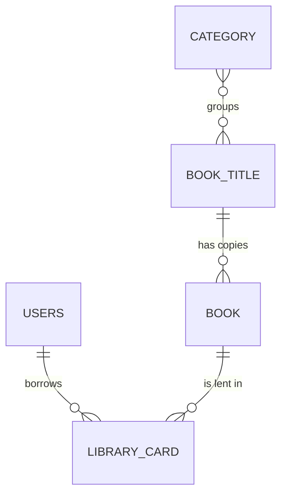

# Library Management System — Backend

REST API for a library: catalogue (titles, categories, physical copies), readers, and the full borrow → return → compensation workflow.

**Java 17 · Spring Boot 3 · Spring Security (OAuth2 Resource Server, JWT HS512) · Spring Data JPA · SQL Server · MapStruct · Docker + Tomcat**

| | |
|---|---|
| API docs | `/swagger-ui.html` once the app is running |
| Size | ~30 endpoints · 6 tables · 3 roles |

---

## What it does

| Role | Main features |
|---|---|
| **Reader** (`USER`) | Browse and search books, borrow a copy, return it, pay compensation, see borrowing history |
| **Librarian** | Manage titles, categories and copies; record returns (on time, late, damaged, lost); manage borrow cards |
| **Admin** | Everything a librarian can do, plus user management |

## Technical highlights

- **Safe concurrent borrowing:** picking an available copy uses a `PESSIMISTIC_WRITE` lock inside a transaction, so two readers borrowing the last copy at the same moment can't both get it.
- **Status tracking:** each physical copy is `AVAILABLE`, `UNAVAILABLE`, `DAMAGED` or `LOST`; each borrow card moves through `BORROWING` → `PENDING_RETURN` → `RETURNED`, or to `OVERDUE` / `NEED_COMPENSATION`.
- **Penalty rules:** a late, damaged or lost return adds a violation. Three violations ban the reader automatically.
- **Role + status authorization:** the JWT carries `role` and `status` claims, mapped to `ROLE_*` and `STATUS_*` authorities. A custom authorization rule lets readers use their endpoints only while the status in their token is `ACTIVE`.
- **Accent-insensitive search:** Vietnamese titles and names are stored with an unaccented copy, so "lap trinh" finds "Lập trình".
- **Clean layering:** controllers → services → repositories, DTOs mapped with MapStruct, one global exception handler with error codes.

## Data model



`Users`, `BookTitle`, `Book` (physical copy), `Category`, `LibraryCard` (one borrow), plus the `Category`–`BookTitle` join table.

## Run it locally

Requirements: Docker Desktop.

```bash
git clone https://github.com/kiins3/BookManager.git
cd BookManager
cp .env.example .env
docker compose up -d --build
```

| Service | URL |
|---|---|
| API | http://localhost:8081 |
| Swagger UI | http://localhost:8081/swagger-ui.html |
| SQL Server | localhost:1434 (sa / `DB_PASSWORD`) |

### Demo accounts

Created on first start (password `Demo@1234`, change it with `DEMO_PASSWORD`):

| Username | Role |
|---|---|
| `admin` | ADMIN |
| `librarian` | LIBRARIAN |
| `reader` | USER |

```bash
curl -X POST localhost:8081/login/token \
  -H 'Content-Type: application/json' \
  -d '{"username":"librarian","password":"Demo@1234"}'
```

Use the returned token as `Authorization: Bearer <token>`. In Swagger, click **Authorize** and paste it.

> Errors come back as HTTP 200 with an application code in the body, e.g. `{"code":508,"message":"You are not allowed to perform this action"}`.

## Configuration

See [`.env.example`](.env.example).

| Variable | Purpose |
|---|---|
| `DB_URL`, `DB_USERNAME`, `DB_PASSWORD` | SQL Server connection |
| `JWT_SECRET` | HS512 signing key, at least 64 characters |
| `SEED_DEMO_USERS`, `DEMO_PASSWORD` | Demo accounts on first start |

## Author

**Tran Hai Dang** — Backend Developer · [GitHub](https://github.com/kiins3) · tranhaidang1128@gmail.com
